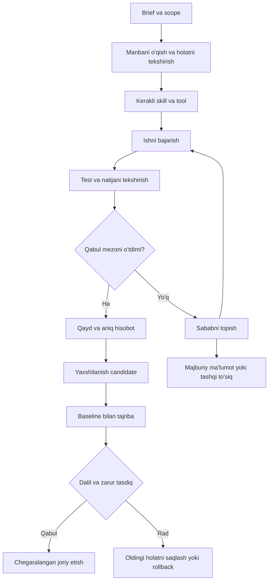

# Codex ish arxitekturasi — 11 bosqich

## Talab va hozirgi chegarasi

[foydalanuvchi qarori, 2026-10-30] Claude uchun aytilgan 11 bandli tizim
Codex'ga moslashtirilib, Obsidian'da Codexning o'zi foydalanadigan kanonik
ish arxitekturasi sifatida saqlansin. Har katta bosqichda brief va savollar
orqali maqsad aniqlansin, keyin dalil bilan tekshirilsin.

[tekshirildi: fayl] Global qoidalar `/Users/protochka/.codex/AGENTS.md`da;
MyBrain context, Preferences, Last Session, shaxsiy skill va RAG kataloglari
mavjud. Bu holat barcha connectorlar, auth, cron yoki RAG health bugun
tekshirilgan degani emas. Mavjud xizmatlar yangidan ko'r-ko'rona qurilmaydi.

Ushbu yozuv — amaliy qo'llanma va qurish rejasi. Global AGENTS/config
qayta yozilmadi; yangi MCP/skill/agent/cron, raw prompt kuzatuvi yoki
avtomatik self-modification yoqilmadi. Lokal qayd remote/cloud sync dalili emas.

## 0-bosqich: audit va brief

Avval muhit xaritasi: joylashuv, egasi, source of truth, ruxsat, oxirgi
tekshiruv va backup/rollback. Keyin Emirhan uchun eng muhim 3 takroriy ish,
kutilgan natija va baholash mezoni aniqlanadi. Audit kod/promptni qayta
qurishdan oldin keladi. Foydali mavjud qatlamlar saqlanadi.

Har aktiv bosqichning kirishi:
- Muammo, foydalanuvchi, trigger va tugagan deb hisoblash mezoni.
- Input/source va output/recipient; qaysi loyiha/vault doirasi.
- Mavjud tasdiqlangan ruxsat, vaqt/xarajat chegarasi va tashqi bog'liqlik.
- Tekshirilgan fakt, taxmin, ochiq savol va tanlangan yechim alohida.

[tekshirildi: lokal katalog qidiruvi, 2026-10-30] `brief` va `grill-me`
nomli SKILL.md fayllari shaxsiy va plugin kataloglarida topilmadi. Bu ularning
hech qayerda mavjud emasligi isboti emas. Manba/yo'riqnoma aniqlanmaguncha
ularni o'rnatilgan yoki qo'llangan skill deb aytmaslik kerak. Hozir shu yerda
berilgan brief/savol usuli — workflow talabi, o'sha skillning nusxasi emas.

Savollar usuli: javobi mavjud manbadan topiladigan savolni userga tashlama;
qolgan eng muhim 1–3 savolni ber, javobga bog'liq bo'lmagan ishni davom ettir.
Majburiy ruxsat yoki source yetishmasa dependent actionni bajarma. Oddiy
so'rovga 11 bosqichli audit majburlanmaydi.

## 11 talabning Codexga mosligi

| № | Dastlabki talab | Codexda roli va chiqish natijasi | Qabul mezoni |
| --- | --- | --- | --- |
| 1 | CLAUDE.md | Global va loyiha AGENTS.md; Preferences va manbalarga qisqa yo'nalish | Global/loyiha doirasi ajralgan, bir-biriga zid qoidalar yo'q |
| 2 | Memory + Obsidian + papkalar | MyBrain shaxsiy context, DantesBrain loyiha memorysi; daily va session handoff | Keyingi sessiya kerakli manba va oxirgi qarorni topadi |
| 3 | Skills | Mavjud Codex skilllarini vazifaga mos qo'llash, yetishmagani uchun kichik SKILL.md | Bitta real workflowda tekshirilgan, keraksiz nusxa yo'q |
| 4 | MCP | Zarur connector/tool, alohida auth va read/write scope | Kerakli read va deny sinovi, sirlar kontekstga chiqmaydi |
| 5 | CAG/RAG | Kichik doimiy context + vazifa bo'yicha source retrieval | Retrieval relevance va javobning manbaga sodiqligi alohida o'lchanadi |
| 6 | Agentlar | Avval bitta asosiy Codex; dalilli ehtiyoj bo'lsa ixtisoslashgan ishchi | Aniq input/output, tool scope, owner va stop sharti |
| 7 | Orkestratsiya/bo'limlar | Ishlarni yo'naltirish, task ownership va handoff grafigi | Bitta taskning ikkita parallel egasi/source-of-truthi yo'q |
| 8 | Cron | Faqat kerakli avtomatizatsiya uchun tasdiqlangan scheduler | Vaqt/zone, recipient, run log, idempotency, retry va o'chirish sinovi |
| 9 | Yaxshilanish sikli | Observe → Diagnose → Propose → Experiment → Evaluate → Deploy/Rollback | Baseline bilan solishtirilgan tajriba, tasdiqlangan joriy etish va qaytish yo'li |
| 10 | Loop/graph engineering | Har workflow uchun holatlar, o'tishlar va invariantlar | Limit, timeout, recovery, audit, terminal state va duplicate nazorati |
| 11 | Takroriy ishlarni avtomatlashtirish | Ruxsatli ish jurnali → candidate backlog → bitta pilot | Odam sarflagan vaqt kamaygan, sifat va xavfsizlik buzilmagan |

[moslashtirish qarori] CAG atamasi bu rejada kichik doimiy kontekst va kerak
bo'lsa prompt caching uchun ishlatiladi; yangi alohida servis shart emas.
Provider/runtime caching imkoniyati implementatsiya oldidan tekshiriladi.
RAG ham xotiraning o'zi emas: u kanonik qayddan manba topish yo'li.

## Nima qayerda turadi

| Ma'lumot | Kanonik joy | Chegara |
| --- | --- | --- |
| Codex global qoidasi | `/Users/protochka/.codex/AGENTS.md` | Qisqa qoidalar va routing; barcha loyiha tafsiloti emas |
| Workspace/loyiha qoidasi | Workspace va tegishli repo AGENTS.md | Shu papka doirasida; uy papkasi bitta monorepo emas |
| Shaxsiy afzalliklar | [[Preferences]] | User tasdiqlagan doimiy afzalliklar |
| Sessiya davomiyligi | [[Last Session]] | Eng yangi holat, natija, ochiq ish, keyingi qadam |
| Umumiy ish modeli | [[Operating System]] va ushbu hujjat | Qoidani ko'paytirmasdan kanonik havolalar |
| Kundalik ish xulosasi | `MyBrain/DAILY/Emirhan/YYYY-MM-DD.md` | Sanitized goal/qaror/natija/source; xom maxfiy chat emas |
| Dantes loyihasi | `/Users/protochka/DantesBrain/00 - Dantes Context.md` | Mijoz memorysi shaxsiy vaultga qayta nusxalanmaydi |
| Kod/test/loyiha skilli | Tegishli Git repo | Credential, session, mijoz DB va private dump Git'ga emas |
| Codex shaxsiy skill | `/Users/protochka/.codex/skills/<nom>/SKILL.md` | Skill yaratish/yangilash skill-creator bilan tekshiriladi |
| Mavjud RAG helper | `/Users/protochka/.codex/rag/` | Health/index/scope tekshirilmasdan ishlaydi deyilmaydi |
| Integratsiya auditi | [[Comfort Setup]] | O'rnatilgan, ulangan va sinalgan holatlar ajratiladi |
| Agent bilim xaritasi | [[Agent Architecture - 33 Levels]] | Har qatlam majburiy emas; ushbu reja ijro ketma-ketligi |
| Runtime secrets/logs/DB | Tegishli servisning private host saqlovi | Vault va repo uchun xom maxfiy nusxa manbasi emas |
| Tajriba/eval natijalari | Bosqich tasdiqlangach tanlanadigan loyiha katalogi | Hozir qo'shimcha katalog yoki log daemon yaratilmagan |

## Qaysi context qachon o'qiladi

Sessiya boshlanishi: Context MOC → Preferences → Last Session → tegishli
loyiha konteksti → amaldagi kod/status. Katta tizim ishida ushbu arxitektura
ham o'qiladi. Butun vault har safar contextga yuklanmaydi.

CAG/context: kichik qoidalar, foydalanuvchi afzalligi va joriy maqsad.
RAG: savolga tegishli kanonik qayd parchasi, source va sana bilan.
Runtime state: ayni taskning phase, pending action va execution natijalari.
Memory: tasdiqlangan preference/qaror/lesson, kelib chiqishi bilan.

RAG natijasi eski bo'lishi mumkin: o'zgaruvchan fakt live fayl/CLI/source
bilan qayta tekshiriladi. Indeksda Dantes va shaxsiy qaydlar bo'lsa ham,
ularni mijoz agentiga to'liq ochish ruxsati kelib chiqmaydi. Permission
filtri content modelga berilishidan oldin ishlashi kerak.

## Codexning ish loopi

Har katta ishda vaqt/turn/tool budjeti va to'xtash sharti belgilanadi.
Sifatli natija olingach yangi dalilsiz bir xil test cheksiz qaytarilmaydi.
Recovery bo'lsa action idempotent bo'lishi va natija izidan qayta tekshirilishi
kerak; tashqi yuborishlar uchun attempt va receipt nazorati zarur.

Agent/bo'lim nomi permission emas. Subagent yoki parallel ish faqat user yoki
amaldagi loyiha/skill yo'riqnomasi ruxsat berganda qo'llanadi. Boshlang'ich
arxitektura uchun ko'p agent, graph DB yoki alohida tashkilot platformasi
majburiy emas. Mavjud task/thread vositalari scheduled notification degani emas.

## Kundalik ishlar va promptlar

[reja] Yig'ish birligi — sana, task, user maqsadining qisqa mazmuni,
ishlatilgan source, muhim qaror, bajarilgan o'zgarish, test natijasi,
artifact/commit havolasi, ochiq ish va automation candidate.

Har bir prompt va javobni xom holda avtomatik eksport qilish hozir yoqilmagan.
Bunday kollektorning manba/retention/doirasi alohida kelishiladi. Token,
parol, sessiya va mijoz shaxsiy suhbatlari umumiy vaultga yozilmaydi.
Tasdiqlangan prompt template sanitized shaklda saqlanishi mumkin.

Muntazam kuzatish faqat ruxsatli task/loglar doirasida: kompyuterning barcha
shaxsiy faoliyatini fon rejimida kuzatish yoqilmagan. Mavjud meaningful
session summary saqlash odati davom etadi.

## Yaxshilanish sikli va o'lchov

Har o'zgarish uchun alohida candidate ID va versiya bo'ladi:

| Qadam | Saqlanadigan dalil |
| --- | --- |
| Observe | Sanitized xatolar, user tuzatishi, test natijasi, vaqt/xarajat |
| Diagnose | Ildiz sabab, misol va taxminning dalildan ajratilishi |
| Propose | Bitta kichik prompt/skill/tool/workflow o'zgarishi va kutilgan foyda |
| Experiment | Izolyatsiyalangan muhit, o'zgarmagan nazorat topshiriqlari |
| Evaluate | Eski/yangi natija, regressiyalar, xavfsizlik va samaradorlik |
| Deploy/Rollback | Mavjud ruxsatlar doirasida, zarur approval bilan, versiya va qaytish yo'li |

[namuna, haqiqiy o'lchov emas] 71.4 → 77.4 faqat bir xil test to'plami,
mezon/model/tool versiyasi va o'xshash sharoitda solishtirilsa ma'noli.
Bitta yaxshi natija bilan "tizim o'sdi" deyilmaydi. Model, dataset yoki
rubric o'zgarsa yangi baseline olinadi; score'ni shu o'zgarish bilan oshirib
ko'rsatish mumkin emas.

Boshlang'ich taklif: vazifa natijasi, manbaga sodiqlik, kerakli paytda
aniqlashtirish, user qayta tuzatishlari, vaqt/xarajat alohida hisoblanadi.
Xavfsizlik/ruxsat buzilishi alohida veto: umumiy ball uni yashirmaydi.
Bir necha sikl foyda bermasa ildiz sabab va benchmark qayta ko'riladi;
cheksiz yangi skill/agent qo'shish yechim emas.

Skill/qoidaga aylantirish: lesson avval candidate, keyin real misol va
tekshiruv yoki user tasdig'i bilan doimiy qoida. O'zini yaxshilash model
weightsini o'zgartirish emas; boshqariladigan kontekst/tool/workflow
versiyalarini yaxshilashdir. Permission/bypass o'z-o'zidan kengaytirilmaydi.

## Avtomatlashtirish candidate'i uchun karta

- Vazifa va necha marta takrorlangani; real source/misollar.
- Bugungi odam vaqti/xatolari; kutilgan foyda.
- Trigger: qo'lda, voqea yoki jadval; aniq timezone.
- Skill/tool/MCP va kerakli read/write/recipient scope.
- Retry/idempotency/duplicate, audit, notification va stop/disable.
- Qabul testi, owner, kerakli tasdiq va rollback.

Oddiy qayd yoki cron ro'yxatiga yozish avtomatik ishlayotgan servis dalili
emas. Tashqi actionlar amaldagi user authorization va vosita qoidalariga
bo'ysunadi; oldin tasdiqlangan reversible ishga qayta-qayta ruxsat so'ralmaydi.

## Qurish backlogi

- [ ] 0: Hozirgi runtime/config/skill/MCP/RAG/cron xaritasi va oxirgi health dalili.
- [ ] 0: Eng muhim uchta takroriy ish uchun brief va baseline.
- [ ] 1–2: Global/project AGENTS va memory routingdagi haqiqiy bo'shliqlarni tuzatish.
- [ ] 2: Daily/prompt log uchun collection va retention doirasini kelishish.
- [ ] 3–4: Mavjud skill/MCPdan bitta workflow uchun yetarli to'plamni tekshirish.
- [ ] 5: Mavjud RAG va context retrievalni manbali nazorat savollarida sinash.
- [ ] 6–7/10: Bitta workflow loop/state/handoffini tekshirish; ehtiyoj bo'lsagina agent ajratish.
- [ ] 8/11: Bitta haqiqiy takroriy ishni tasdiqlangan jadval/trigger bilan pilot qilish.
- [ ] 9: Shu pilot uchun baseline/candidate/eval/rollback siklini bajarish.
- [ ] brief/grill-me skilllarining aniq manba va kerakli ko'lamini aniqlash.

## Rasmiy manbalar va bog'liq qaydlar

OpenAI hujjatlarida AGENTS.md tan olinadigan instruction fayli ekani,
qo'shimcha context fayllari esa workflow konvensiyasi sifatida moslashtirilishi
ko'rsatilgan. Bizning papka/metric/backlog tuzilishimiz — loyiha taklifi,
Codexning avtomatik native memory yoki scheduler konfiguratsiyasi emas.

- [Iterating Development Workflows with Codex](https://developers.openai.com/cookbook/examples/codex/iterating-development-workflows-with-codex)
- [Skills va MCP workflow roli](https://developers.openai.com/plugins/concepts/skills)
- [[Context MOC]], [[Preferences]], [[Last Session]], [[Operating System]].
- [[Comfort Setup]], [[Agent Architecture - 33 Levels]], [[Beluga Mem0 and RAG]].

Tekshiruv: yangi note va havolalar qayta o'qiladi, Markdown whitespace hamda
MyBrain Git status tekshiriladi. Ushbu bosqich faqat hujjatlashtirish.

## 2026-10-30 — 3-bosqichning Obsidian qismi bajarildi

- [x] AITMPL katalogidagi Obsidian format/maintenance usullarini Codexga
  moslashtirish: 5 yangi skill, mavjud obsidyan-skillga routing/log tartibi.
- [x] Source/litsenziya/pinned commit, skill validation va read-only helper
  testlarini qayd qilish; Canvas va filtered Base namunasi.
- [ ] To'liq 11 bosqich runtime auditi, missing brief/grill-me, live RAG/MCP/
  cron health va nazoratli self-improvement hali alohida backlogda.

Dalil va cheklovlar: [[AITMPL Obsidian - Codex moslashtirish 2026-10-30]]. Yuqoridagi “yangi skill o'rnatilmadi”
jumlasi dastlabki hujjatlashtirish holatini bildiradi; ushbu sanali qadam
Obsidian skill qatlamini qisman implementatsiya qildi. Global config va
fon servislar o'zgarmadi.
